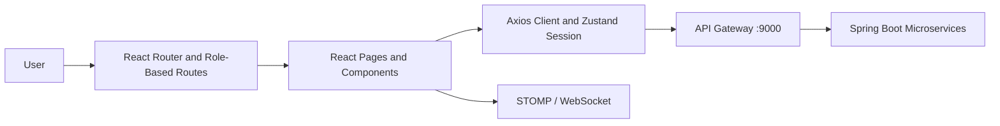

# OCP Collaborative Platform · Frontend

**A React-based interface designed to organize teams, manage projects, and facilitate communication within a collaborative platform.**

The frontend brings together dedicated workspaces for administrators, directors, managers, and employees. It communicates with Spring Boot microservices through an API Gateway and uses JWT-based sessions to adapt navigation and access according to the authenticated user's role.


*Actual screenshot from a QA manager session. Account information has been hidden. This screenshot does not constitute validation of all application features.*

## Explore the Project

- [Interface Demonstration: Six Documented Screenshots](docs/presentation/INTERFACES.md)
- [Installation, Configuration, and Build](docs/presentation/GETTING_STARTED.md)
- [Architecture and Collaboration Contracts](docs/ERP_COLLABORATION_INTEGRATION.md)
- [QA Testing Results](https://github.com/FATIMA-BOUSMITI/Collaborative-Platform-QA/blob/main/docs/results/README.md)

## The Three Repositories

| Component | Repository | Responsibility |
| --- | --- | --- |
| Frontend | [Platform-collaboration-ocp-frontend](https://github.com/FATIMA-BOUSMITI/Platform-collaboration-ocp-frontend) | React interfaces, navigation, and API integration |
| Backend | [Platform-collaboration-ocp-backend](https://github.com/FATIMA-BOUSMITI/Platform-collaboration-ocp-backend) | Spring Boot services, authentication, and data persistence |
| QA Automation | [Collaborative-Platform-QA](https://github.com/FATIMA-BOUSMITI/Collaborative-Platform-QA) | Selenium, Robot Framework, k6, and test execution evidence |

## Application Features

| Module | Available Interfaces |
| --- | --- |
| Authentication | Login, form validation, password recovery, and password reset |
| Administration | Dashboard, users, departments, teams, roles, permissions, and sessions |
| Role-Based Workspaces | Director, manager, and employee dashboards |
| Projects and Kanban | Project overview, task management interfaces, Kanban columns, and progress tracking |
| Collaboration | Document management, messaging, and notifications |

The presence of an interface in the source code does not guarantee that its backend integration has been fully validated.

Published screenshots represent the actual application states observed during testing.

## Frontend Architecture



### Core Technologies

- **React Router:** Manages public routes and protected role-based workspaces.
- **Zustand:** Maintains the session state used throughout the application.
- **Axios:** Centralizes HTTP requests, bearer token injection, and session renewal.
- **STOMP/WebSocket:** Supports the real-time communication mechanisms designed for collaborative modules.
- **dnd-kit:** Enables drag-and-drop interactions within the Kanban interface.

Frontend access restrictions improve navigation and user experience. However, actual authorization rules must also be enforced and validated by backend APIs.

## Quick Start

### Prerequisites

- **Node.js 22.12 or later**
- npm
- Accessible backend services

No authentication credentials are required to display public forms.

### Clone and Run

```powershell
git clone https://github.com/FATIMA-BOUSMITI/Platform-collaboration-ocp-frontend.git

cd Platform-collaboration-ocp-frontend

npm ci

npm run dev
```

Open the application at:

`http://localhost:5173`

By default, the backend API is configured at:

`http://localhost:9000/api`

### Environment Configuration

To customize the backend connection, create a local `.env.local` file that is not committed to version control:

```dotenv
VITE_API_URL=http://localhost:9000/api
VITE_WS_URL=ws://localhost:9000/ws
```

`VITE_WS_URL` is optional if the application can derive the WebSocket URL from the API URL.

**Security Note:** Environment variables prefixed with `VITE_` are exposed to the browser and must never contain passwords, API secrets, or other sensitive credentials.

## Build and Local Validation

The project provides the following commands:

```powershell
npm run test:session  # Node.js tests for session helpers

npm run lint          # Static code analysis

npm run build         # TypeScript validation and dist/ generation

npm run preview       # Preview the local production build
```

These commands represent the available development and validation entry points.

This documentation update does not claim that a new lint execution, production build, or application test run has been successfully completed.

### Production Deployment

The generated `dist/` directory can be served through a static hosting provider configured with a fallback to `index.html` for React routes.

The production API URL must be configured at build time.

## Docker and Full Environment Setup

The Docker and Compose configuration available in the **[Backend Repository](https://github.com/FATIMA-BOUSMITI/Platform-collaboration-ocp-backend)** builds the six backend microservices.

This frontend repository does not currently contain a Dockerfile.

Therefore, the documented development setup runs:

- Backend microservices using Docker Compose.
- React frontend using Vite.

No existing frontend Docker image is assumed.

### Start Backend Services

From the backend repository, after configuring the required private environment variables:

```powershell
docker compose --env-file .env.local build

docker compose --env-file .env.local up -d
```

Then start the frontend from this repository:

```powershell
npm run dev
```

Refer to the [Backend Setup Guide](https://github.com/FATIMA-BOUSMITI/Platform-collaboration-ocp-backend/blob/master/docs/presentation/RUNNING.md) for database requirements and environment configuration.

## Demonstration and Observed Application Status

The following observations were recorded during the local QA demonstration on **October 28, 2026**.

| Component | Observed Behavior |
| --- | --- |
| Public Interfaces | Login, form validation, password recovery, and invalid password reset link screens captured |
| QA Manager Account | Successful authentication and manager dashboard displayed |
| Projects / Kanban | Interface displayed; project retrieval returned HTTP 500 |
| Configured Administrator Account | Authentication rejected with HTTP 401; no authenticated administrator screen published |
| User Profile | HTTP 200 and HTTP 504 responses observed across different attempts |
| Notification Counter | HTTP 404 response observed |

### Demonstration Environment

The demonstration used:

- The local frontend from `Ger`, which contained uncommitted modifications.
- Previously compiled backend JAR files.
- Actual HTTP responses from the running services.

### Validation Limitations

The demonstration does not establish an exact correspondence with a published Git commit.

Additionally:

- No API responses were simulated.
- No business data modification requests were submitted.
- The screenshots represent observed application behavior rather than complete functional validation.

These limitations are documented to maintain transparency and distinguish implemented interfaces from fully validated integrations.

## Testing and QA Automation

Session-related tests that are closely coupled to the frontend remain in this repository.

Browser-based functional tests, API validation, and performance testing scenarios are maintained in the dedicated **[QA Automation Repository](https://github.com/FATIMA-BOUSMITI/Collaborative-Platform-QA)**.

### Testing Organization

| Testing Area | Location | Purpose |
| --- | --- | --- |
| Session Helper Tests | Frontend Repository | Validate session-related utility behavior |
| UI Automation | QA Repository | Validate browser interactions and user workflows |
| API Testing | QA Repository | Verify API responses and integration behavior |
| Performance Testing | QA Repository | Evaluate application behavior under simulated workloads |

### QA Technologies

The dedicated QA repository includes:

- **Selenium:** Browser automation and functional UI testing.
- **Robot Framework:** Automated REST API testing.
- **k6:** Performance and load testing scenarios.
- **GitHub Actions:** CI workflow integration and automated execution.

This separation allows internal frontend checks to evolve alongside the application while maintaining independent, cross-service validation of frontend/backend interactions.

QA reports distinguish historical execution results, identified defects, and test coverage limitations.

## Technical Documentation

| Document | Description |
| --- | --- |
| [Interface Screenshots](docs/presentation/INTERFACES.md) | Documented screenshots and observed interface states |
| [Installation and Build](docs/presentation/GETTING_STARTED.md) | Setup instructions and development commands |
| [API Contracts](docs/COLLABORATION_API.md) | API specifications and collaboration contracts |
| [Collaborative Module Integration](docs/ERP_COLLABORATION_INTEGRATION.md) | Integration details for collaborative features |
| [Notifications](docs/ERP_NOTIFICATIONS_PHASE5.md) | Notification module documentation |
| [Backend Repository](https://github.com/FATIMA-BOUSMITI/Platform-collaboration-ocp-backend) | Spring Boot microservices and backend implementation |
| [QA Automation and Reports](https://github.com/FATIMA-BOUSMITI/Collaborative-Platform-QA) | Automated testing suites, execution evidence, and reports |

## Contributions

Application development contributions can be reviewed through the Git history.

The demonstration documentation and QA testing evidence were prepared by **Fatima Bousmiti**.

These contributions are documented without presenting the entire application development process as the work of a single individual.
