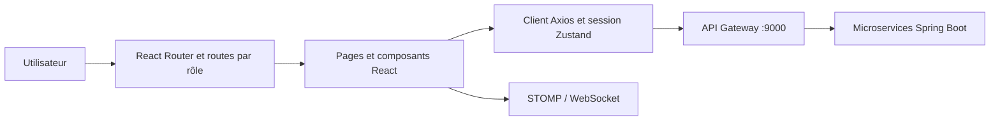

# Plateforme collaborative OCP · Frontend

**Une interface React pour organiser les équipes, les projets et les échanges au sein d'une plateforme collaborative.**

Le frontend réunit les espaces administrateur, directeur, manager et employé. Il communique avec les microservices Spring Boot via une API Gateway et s'appuie sur une session JWT pour adapter la navigation au rôle connecté.


*Capture réelle d'une session QA manager. Les informations de compte ont été masquées. La capture ne constitue pas une validation de toutes les fonctionnalités.*

## Découvrir le projet

- [Démonstration des interfaces : six captures commentées](docs/presentation/INTERFACES.md).
- [Installation, configuration et build](docs/presentation/GETTING_STARTED.md).
- [Architecture et contrats de collaboration](docs/ERP_COLLABORATION_INTEGRATION.md).
- [Résultats des tests QA](https://github.com/FATIMA-BOUSMITI/Collaborative-Platform-QA/blob/main/docs/results/README.md).

## Les trois dépôts

| Composant | Dépôt | Responsabilité |
| --- | --- | --- |
| Frontend | [Platform-collaboration-ocp-frontend](https://github.com/FATIMA-BOUSMITI/Platform-collaboration-ocp-frontend) | Interfaces React, navigation et appels API |
| Backend | [Platform-collaboration-ocp-backend](https://github.com/FATIMA-BOUSMITI/Platform-collaboration-ocp-backend) | Services Spring Boot, authentification et persistance |
| QA Automation | [Collaborative-Platform-QA](https://github.com/FATIMA-BOUSMITI/Collaborative-Platform-QA) | Selenium, Robot Framework, k6 et preuves d'exécution |

## Fonctionnalités de l'interface

| Espace | Interfaces disponibles dans le code |
| --- | --- |
| Authentification | Connexion, validation de formulaire, récupération et réinitialisation du mot de passe |
| Administration | Tableau de bord, utilisateurs, départements, équipes, rôles, permissions et sessions |
| Espaces métier | Tableaux de bord directeur, manager et employé |
| Projets et Kanban | Consultation des projets et interfaces de tâches, colonnes et progression |
| Collaboration | Documents, messagerie et notifications |

La présence d'un écran dans le code n'atteste pas que chaque intégration backend a été validée. Les captures publiées montrent les états réellement observés.

## Architecture frontend



- **React Router** organise les routes publiques et les espaces protégés.
- **Zustand** conserve l'état de session utilisé par l'interface.
- **Axios** centralise les appels HTTP, l'ajout du bearer token et le renouvellement de session.
- **STOMP/WebSocket** porte les échanges temps réel prévus par les modules collaboratifs.
- **dnd-kit** est utilisé pour les interactions de déplacement du Kanban.

Les restrictions frontend facilitent la navigation ; les autorisations effectives doivent également être vérifiées par les API.

## Démarrage rapide

Prérequis : **Node.js 22.12 ou supérieur**, npm et backend accessible. Aucun identifiant n'est nécessaire pour afficher les formulaires publics.

```powershell
git clone https://github.com/FATIMA-BOUSMITI/Platform-collaboration-ocp-frontend.git
cd Platform-collaboration-ocp-frontend
npm ci
npm run dev
```

Ouvrir `http://localhost:5173`. Le backend est configuré par défaut sur `http://localhost:9000/api`.

Pour changer la cible, créer un fichier `.env.local` non versionné :

```dotenv
VITE_API_URL=http://localhost:9000/api
VITE_WS_URL=ws://localhost:9000/ws
```

`VITE_WS_URL` est facultatif si l'application peut le déduire de l'URL API. Les variables `VITE_*` sont exposées au navigateur : elles ne doivent contenir aucun secret.

## Build et contrôles locaux

```powershell
npm run test:session  # Tests Node des helpers de session
npm run lint          # Analyse statique
npm run build         # Vérification TypeScript et génération de dist/
npm run preview       # Prévisualisation du build local
```

Ces commandes sont les points d'entrée disponibles ; cette mise à jour documentaire ne revendique pas une nouvelle réussite de lint, build ou tests applicatifs.

Le dossier `dist/` peut être servi par un hébergement statique configuré avec un fallback vers `index.html` pour les routes React. L'URL API utilisée en production doit être fournie au moment du build.

## Docker et environnement complet

Les fichiers Docker/Compose du **[dépôt backend](https://github.com/FATIMA-BOUSMITI/Platform-collaboration-ocp-backend)** construisent les six services serveur. Ce dépôt frontend ne contient pas de Dockerfile : le parcours documenté lance donc le backend avec Compose et le frontend avec Vite, sans inventer une image frontend existante.

Depuis le clone backend, après configuration privée :

```powershell
docker compose --env-file .env.local build
docker compose --env-file .env.local up -d
```

Puis lancer `npm run dev` dans ce dépôt. Voir [le guide backend](https://github.com/FATIMA-BOUSMITI/Platform-collaboration-ocp-backend/blob/master/docs/presentation/RUNNING.md) pour les bases et paramètres requis.

## Démonstration et état observé

| Élément | Observation pendant la capture locale du 28 octobre 2026 |
| --- | --- |
| Écrans publics | Connexion, validation, récupération et lien de réinitialisation invalide capturés |
| Compte QA manager | Connexion réelle réussie et tableau de bord affiché |
| Projets / Kanban | Interface affichée ; lecture des projets en erreur HTTP 500 |
| Compte administrateur configuré | Connexion refusée HTTP 401 ; aucun écran admin authentifié publié |
| Profil utilisateur | Réponses 200 et délai 504 selon les tentatives |
| Compteur de notifications | Réponse HTTP 404 observée |

La démonstration utilise le frontend local de `Ger`, qui comportait des modifications non commitées, et des JAR backend déjà compilés. Elle n'est pas une preuve de correspondance exacte avec un commit publié. Aucune réponse API n'a été simulée et aucune écriture métier n'a été soumise.

## Tests et dépôt QA

Les tests de session proches du frontend restent ici. Les parcours navigateur, contrôles API et scénarios de performance sont maintenus dans le **[dépôt QA](https://github.com/FATIMA-BOUSMITI/Collaborative-Platform-QA)**.

Ce découpage permet de faire évoluer les contrôles internes avec l'application tout en conservant une validation transversale des interactions frontend/backend. Les rapports QA distinguent résultats historiques, anomalies et limites de couverture.

## Documentation technique

- [Captures des interfaces](docs/presentation/INTERFACES.md)
- [Installation et build](docs/presentation/GETTING_STARTED.md)
- [Contrats API](docs/COLLABORATION_API.md)
- [Intégration des modules collaboratifs](docs/ERP_COLLABORATION_INTEGRATION.md)
- [Notifications](docs/ERP_NOTIFICATIONS_PHASE5.md)
- [Code backend](https://github.com/FATIMA-BOUSMITI/Platform-collaboration-ocp-backend)
- [Automatisation et résultats QA](https://github.com/FATIMA-BOUSMITI/Collaborative-Platform-QA)

## Contributions

Les contributions applicatives sont consultables dans l'historique Git. La documentation de démonstration et les preuves QA sont préparées par **Fatima Bousmiti** ; elles ne présentent pas l'ensemble du développement applicatif comme un travail individuel.
