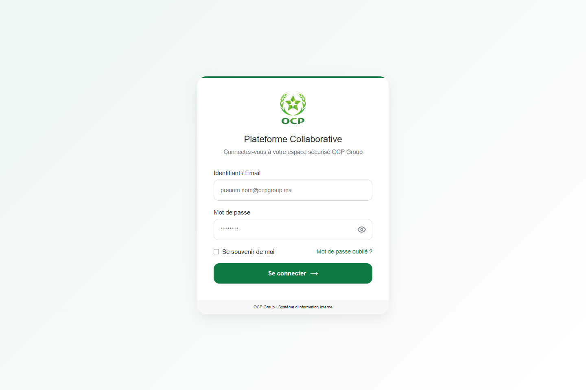
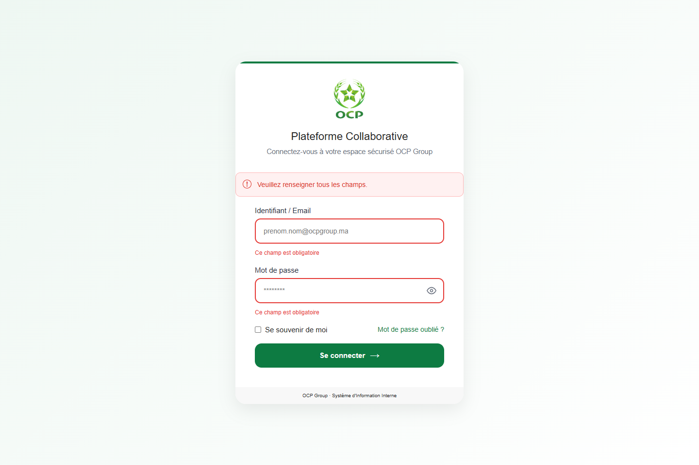
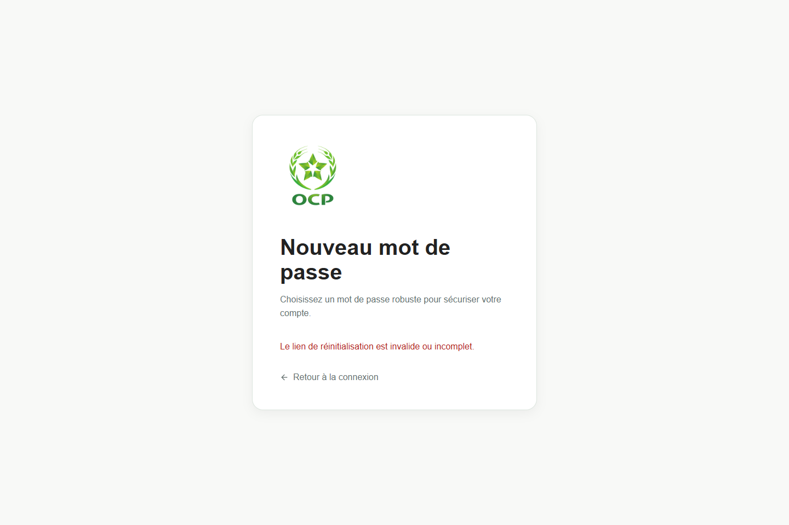
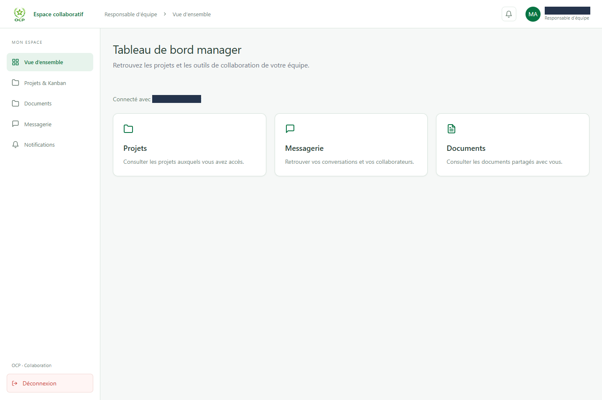
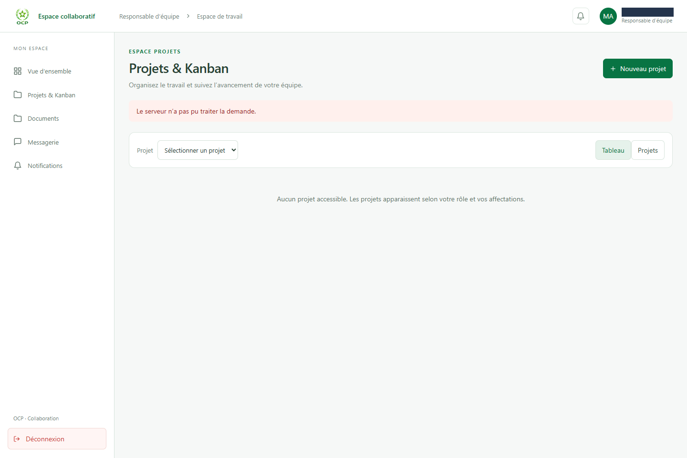

# Démonstration des interfaces frontend

Six captures réelles issues de la session QA locale du 28 octobre 2026. Aucun écran n'est une maquette générée et aucune réponse API n'a été simulée. Les informations personnelles sont masquées lors de la capture.

Le frontend local comportait des modifications non commitées. Les images décrivent cet environnement de démonstration ; elles ne certifient pas le rendu exact d'un commit publié.

## 1. Authentification

Formulaire de connexion réel, affiché sans identifiants.

## 2. Validation des champs obligatoires

Validation des champs obligatoires après soumission vide. Aucun appel de connexion réussi n'est déduit de cette capture.

## 3. Mot de passe oublié

Écran de récupération affiché sans soumission ni envoi d'e-mail.

## 4. Lien de réinitialisation absent

État de réinitialisation sans token : le lien est signalé comme invalide ou incomplet.

## 5. Tableau de bord manager

Tableau de bord affiché après une connexion réelle du compte QA manager. Les informations personnelles sont masquées.

## 6. Projets et Kanban

Interface Kanban avec l'erreur réelle de chargement des projets. Le backend renvoie 500 : aucun projet rempli n'a été fabriqué pour la capture.

## Périmètre de la démonstration

Le manager a pu se connecter et naviguer vers son tableau de bord et le Kanban. Les projets ont renvoyé 500, le compteur de notifications 404, et le profil a aussi renvoyé un délai 504 lors d'une autre tentative. Le compte administrateur a reçu 401 ; les écrans admin ne sont donc pas représentés comme validés.

Aucun utilisateur, projet ou tâche n'a été créé, modifié ou supprimé pour ces captures. Les opérations d'authentification ont pu créer des sessions et entrées d'audit. L'affichage des formulaires de mot de passe ne valide pas leur traitement ni l'envoi d'e-mails.

- [Manifeste expurgé des captures](capture-manifest.json)
- [Backend et observations API](https://github.com/FATIMA-BOUSMITI/Platform-collaboration-ocp-backend/blob/master/docs/presentation/DEMONSTRATION.md)
- [Démonstration QA complète](https://github.com/FATIMA-BOUSMITI/Collaborative-Platform-QA/blob/main/docs/demo/README.md)
- [Résultats des tests automatisés](https://github.com/FATIMA-BOUSMITI/Collaborative-Platform-QA/blob/main/docs/results/README.md)

Ces captures illustrent des états de l'interface et restent distinctes des rapports de tests.
